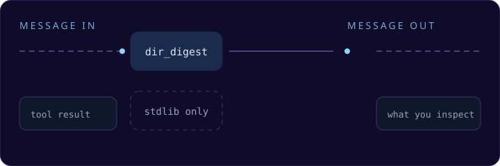

<p align="center">
  
</p>

<p align="center">
  <a href="https://pypi.org/project/dir-digest/"></a>
  <a href="https://pypi.org/project/dir-digest/"></a>
  <a href="https://pypi.org/project/dir-digest/"></a>
  <a href="https://github.com/sandeshbagmare/dir-digest/actions/workflows/ci.yml"></a>
  <a href="https://github.com/sandeshbagmare/dir-digest/blob/main/LICENSE"></a>
  <a href="https://sandeshbagmare.github.io/dir-digest/"></a>
  <a href="https://pypi.org/project/dir-digest/"></a>
</p>

<h3 align="center">one hash for a directory tree, identical on every OS</h3>
<p align="center"><em>Standard library only. No runtime dependencies. Python 3.9+.</em></p>

<p align="center">
  
</p>

## Install

```console
pip install dir-digest
```

## Use

```python
from dir_digest import digest_tree, file_digests

digest_tree("src")                                   # one hex digest
digest_tree("src", algorithm="sha1", patterns=["*.pyc"])
file_digests("src")                                  # {"a.py": "…", "pkg/b.py": "…"}
```

```console
dir-digest DIR [--algorithm sha256] [--ignore PATTERN]… [--no-gitignore] [--files] [--json]
```

## How the digest is built

```
hash( for each file, sorted by relative path:
        relative_path + NUL + hash_of_contents + NUL )
```

- paths are POSIX style, so a Windows run and a Linux run agree
- the path is hashed too, so a rename is a change
- NUL separators mean the concatenation is unambiguous
- symlinks are skipped unless `follow_symlinks=True`, so a link to a large tree does
  not silently change the digest
- mtimes, permissions and owners are not used at all

## Ignore rules

`.gitignore` in the root is read by default (`gitignore=False` turns it off), and
`patterns=` accepts the same syntax:

| pattern | matches |
| ------- | ------- |
| `*.pyc` | any depth |
| `docs/*.md` | a path, from the root |
| `docs/**/a.md` | any depth under `docs` |
| `build/` | a directory only |
| `/top.log` | anchored to the root |
| `!keep.log` | un-ignores; the last matching rule wins |

This is the subset of gitignore people actually write — comments, negation, `*`, `?`,
`**`, character classes, trailing-slash directories and leading-slash anchoring.

## Limits

- No hard links, submodules or file modes: content and names only.
- A `.gitignore` inside a subdirectory is not read; pass `patterns=` for those.
- Reading is single threaded and chunked at 1 MiB, which is fast enough for source
  trees but not a substitute for a specialised filesystem scanner.

## Development

```console
python -m venv .venv
.venv/bin/pip install -e ".[test]"
.venv/bin/pytest
```

The suite covers every line of the package (`pytest --cov --cov-branch`), and the
examples in the docstrings run as tests through `--doctest-modules`.

## License

MIT.
